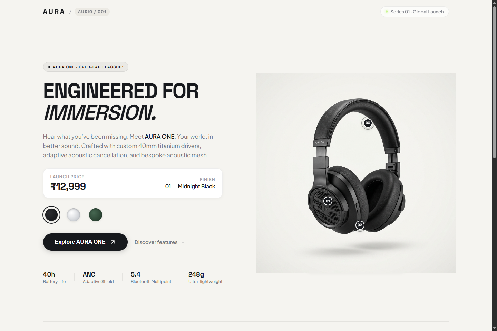
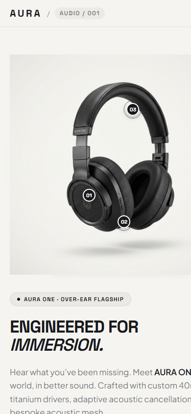

# AURA ONE — Premium Wireless Headphones Showcase

> An interactive, responsive product experience designed for Framer, demonstrating components, variants, variables, interactive hotspots, and scroll-driven transforms.

---

## 🎧 Product Overview: AURA ONE

- **Product Name**: AURA ONE
- **Tagline**: Sound that moves with you.
- **Price**: ₹12,999
- **Color Finishes**:
  - `01 — Midnight Black` (Matte black finish & dark acoustic mesh)
  - `02 — Titanium Silver` (Brushed titanium & aluminum arms)
  - `03 — Forest Green` (Deep emerald matte anodized finish & brass trim)
- **Key Specifications**:
  - 40 Hours Battery Life (with USB-C 10m quick-charge boost)
  - Adaptive ANC (Cancels up to 38 dB of ambient noise at 48,000 samples/sec)
  - Bluetooth 5.4 Multipoint (Ultra-low 35ms latency)
  - Ultra-lightweight (248g ergonomic memory foam chassis)

---

## 📸 Application Screenshots

### 1. Desktop Showcase (Section A & B: Product Showcase & Interactive Hotspots)


### 2. Mobile Responsive Layout (390px Breakpoint)


---

### Sections Implemented:
1. **Section A — Main Showcase**:
   - Product headline, description, category pill (`AUDIO / 001`).
   - Dynamic price and selected finish label synchronized with swatches.
   - Interactive color swatches (`Default`, `Hover`, `Active` states) driving smooth 320ms crossfade between headphone models.
   - Primary CTA with micro-interactions.
2. **Section B — Interactive Hotspots**:
   - Three clickable markers with pulsating radar ping rings placed over key headphone features:
     - **Hotspot 01: Adaptive ANC** (acoustic driver mesh)
     - **Hotspot 02: 40h Battery Life** (USB-C base port)
     - **Hotspot 03: All-Day Comfort** (headband memory foam)
   - Expanding floating glassmorphic information cards with specs and dismiss controls.
3. **Section C — Scroll Experience**:
   - Scroll-driven subtle parallax elevation (-32px) and scale (1.0 -> 1.04) on the product hero.
   - Staggered reveal animations for deep-dive architecture cards (Titanium Drivers, Spatial Audio, Bluetooth 5.4).

---

## 🛠️ Tech Stack & Framer Design System

- **Background**: `#F5F4F0` (Scandinavian warm off-white)
- **Primary Text**: `#17191D`
- **Secondary Text**: `#747780`
- **Accent**: `#B8F36B` (Neon lime)
- **Border Radius**: `20px` (Cards), `100px` (Buttons)
- **Typography**: Space Grotesk (Display / Headings) & Plus Jakarta Sans (Body)
- **Breakpoints**: Desktop (`1440px`), Mobile (`390px` touch-first responsive)

---

## 📁 Repository Structure

```
├── assets/
│   ├── aura-black.jpg     # 3D Studio render (Midnight Black)
│   ├── aura-silver.jpg    # 3D Studio render (Titanium Silver)
│   └── aura-green.jpg     # 3D Studio render (Forest Green)
├── index.html             # Standalone interactive showcase page
├── style.css              # Complete design system & responsive stylesheet
├── app.js                 # Variant crossfades, hotspot interactions & scroll observer
├── AuraProductShowcase.tsx# Framer React Code Component with property controls
└── README.md              # Project documentation
```

---

## ⚡ Quick Start / Local Preview

To run the standalone preview locally:

```bash
# Using Python
python -m http.server 8080

# Then open in your browser:
http://localhost:8080
```

---

## 🎨 How to Use in Framer

1. Create a blank Framer project.
2. In the **Assets** tab $\rightarrow$ **Code**, click `+` and paste `AuraProductShowcase.tsx`.
3. Drag the component onto your canvas.
4. Upload `aura-black.jpg`, `aura-silver.jpg`, and `aura-green.jpg` from the `/assets` directory into the component inspector.
5. Hit **Publish**!
